# Лабораторная работа №4. Облачные хранилища. Amazon S3

| | |
|---|---|
| **Студент** | Noroc Eugeniu |
| **Группа** | IA2404 |
| **Специальность** | Informatică aplicată |
| **Уровень** | Продвинутый |
| **Регион AWS** | eu-north-1 (Stockholm) |
| **Бакет** | `timecapsule-dev-uploads-eugeniu-noroc` |
| **Репозиторий** | https://github.com/eugeniu-noroc-cloud/timecapsule |

> Работа выполнялась в регионе **eu-north-1 (Stockholm)** вместо eu-central-1, как и ЛР2–ЛР3: в этом регионе находятся сеть и серверы приложения. Во всех командах используется endpoint `s3.eu-north-1.amazonaws.com`. Приложение на сервере расположено в `/var/www/timecapsule` (без каталога `current`).

Все ресурсы созданы с тегами `Name`, `Project=timecapsule`, `Environment=dev`, `Owner=eugeniu-noroc-cloud`, `Lab=lab4`.

---

## Часть 1. Базовый уровень

### Задание 1. Бакет и объекты в консоли

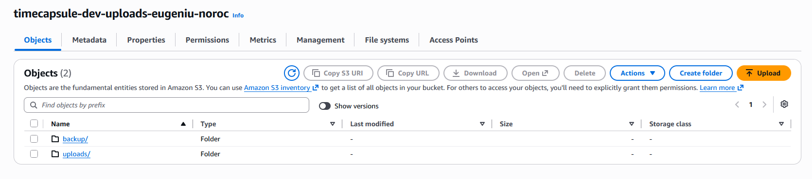  
*Бакет с «папками» `uploads/` и `backups/`.*

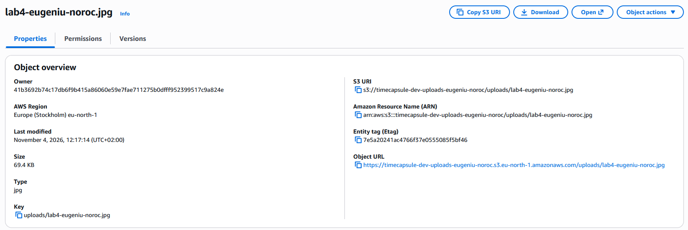  
*Свойства картинки: ключ, тип, ETag, Object URL.*

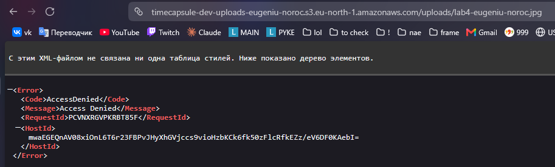  
*Открытие Object URL в браузере: `AccessDenied`.*

**Какой ключ у картинки? Почему Object URL не открывается? Что создала кнопка Create folder?**
Ключ картинки — `uploads/lab4-eugeniu-noroc.jpg`: в S3 нет папок, есть только ключи объектов, и «путь» — это часть имени. Object URL не открывается, потому что браузер отправляет анонимный запрос без подписи: для S3 это не владелец, а «кто угодно», а бакет закрыт Block Public Access. Права владельца действуют только для подписанных запросов (консоль, CLI, SDK). Кнопка Create folder создала пустой объект нулевого размера с ключом `uploads/`, который консоль показывает как папку.

### Задание 2. Объекты из командной строки

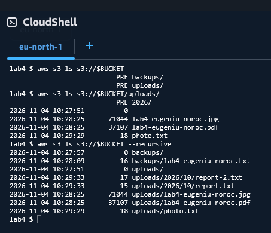  
*Вывод `aws s3 ls` для корня, префикса `uploads/` и с `--recursive`.*

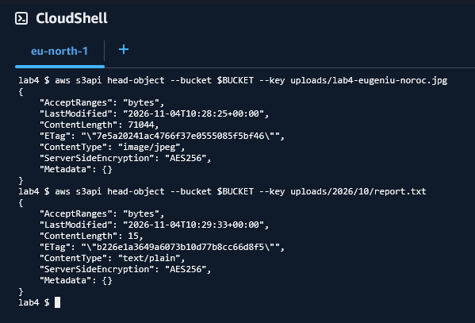  
*Метаданные картинки и `uploads/2026/10/report.txt` без скачивания.*

**Почему первая команда показывает `PRE uploads/`, а третья — полные ключи? Какой Content-Type получил report.txt?**
Без `--recursive` CLI запрашивает список с разделителем `/` и группирует ключи по общему префиксу до первого `/`, показывая их как `PRE` («каталоги»). С `--recursive` разделитель не используется, и выводятся все ключи целиком. `report.txt` получил `ContentType: text/plain`: AWS CLI сам определил тип по расширению файла при загрузке.

### Задание 3. Политика бакета: только HTTPS

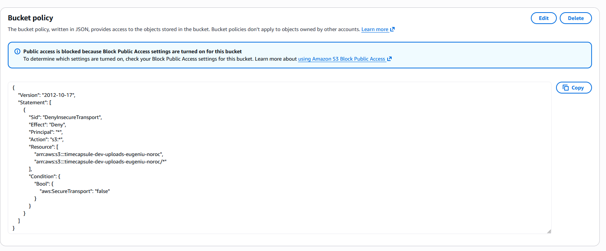  
*Политика бакета: Deny для всех при `aws:SecureTransport = false`.*

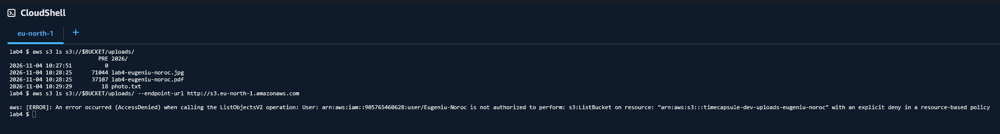  
*По HTTPS список выводится, по HTTP — `AccessDenied ... explicit deny in a resource-based policy`.*

**Почему вторая команда получает AccessDenied, хотя у вас права администратора? Почему Block Public Access не помешал сохранить политику с `"Principal": "*"`?**
В AWS явный запрет (Deny) всегда сильнее любого разрешения: AdministratorAccess разрешает всё, но Deny в политике бакета срабатывает раньше, и запрос по HTTP отклоняется для любого участника, включая администратора. Block Public Access блокирует только политики, которые **разрешают** публичный доступ. Политика с `Effect: Deny` доступ только сужает, поэтому сохраняется без ошибок.

### Задание 4. Версионирование и защита от удаления

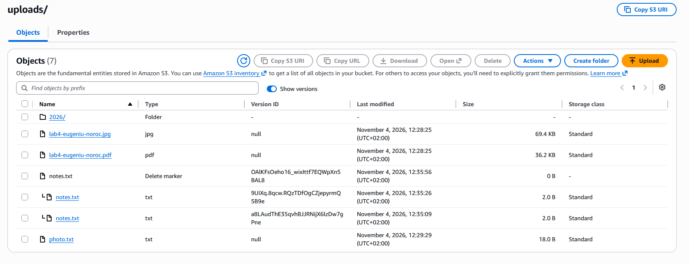  
*У `notes.txt` появился маркер удаления над версиями v2 и v1; у файлов, загруженных до включения версионирования, Version ID = `null`.*

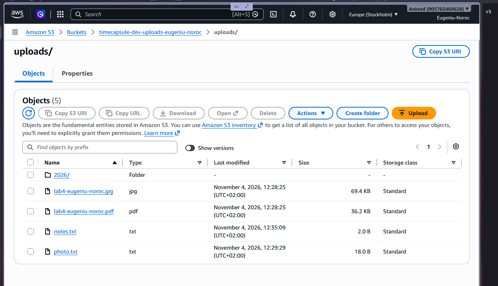  
*После удаления версии v2 текущей стала v1.*

**Чем удаление в шаге 3 отличается от удаления в шаге 5? Какое можно отменить? Какое защищает, а какое нужно запрещать приложению?**
В шаге 3 удаление без указания версии не стирает данные: S3 добавляет маркер удаления, и объект просто перестаёт быть виден. Это отменяется удалением маркера. В шаге 5 удаляется конкретная версия (`DeleteObjectVersion`) — это необратимо, поэтому консоль требует ввести `permanently delete`. Первый способ защищает от случайного удаления, второй нужно запрещать приложению: в его политике нет `s3:DeleteObjectVersion`.

### Задание 5. Правило жизненного цикла

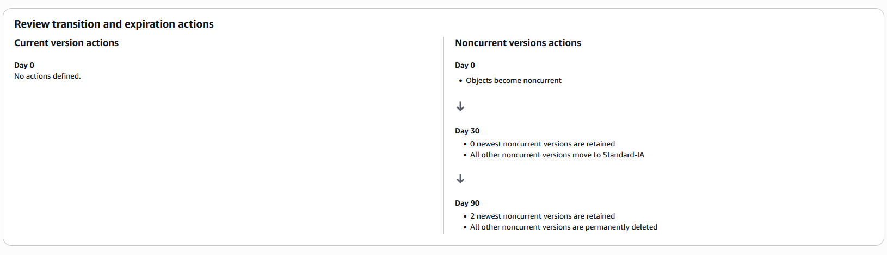  
*Схема правила `timecapsule-dev-noncurrent` для префикса `uploads/`.*

**Как поведёт себя правило для файла, который перезаписывали 10 раз за неделю? Почему тестовые файлы не попадут в Standard-IA? Что такое незавершённая загрузка частями?**
После 10 перезаписей у файла одна текущая версия и 10 неактуальных. Каждая неактуальная версия через 30 дней после того, как её перезаписали, переходит в Standard-IA. Через 90 дней удаляются все неактуальные версии, кроме двух самых новых. Текущая версия правилом не затрагивается. Наши тестовые файлы меньше 128 КБ, а по умолчанию S3 не переводит такие объекты в Standard-IA: стоимость перехода и минимальный оплачиваемый размер класса съели бы экономию. Загрузка частями (multipart upload) делит большой файл на части; если загрузку начали и не завершили, уже загруженные части хранятся невидимо для списка объектов и оплачиваются, пока их не удалит правило через 7 дней.

### Задание 6. Подписанные URL

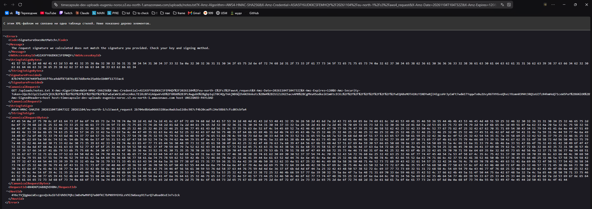  
*Ссылка, в которой `photo.txt` заменён на `notes.txt`: `SignatureDoesNotMatch`.*

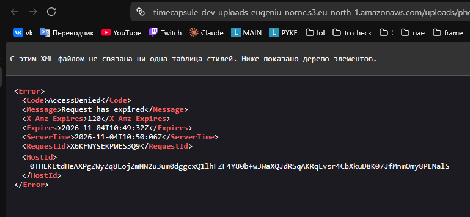  
*Та же ссылка после 2 минут: `AccessDenied — Request has expired`.*

**Какие ошибки вернул S3? Почему нельзя получить другой файл, поменяв ключ? Обращалась ли `aws s3 presign` к S3?**
В шаге 3 — `SignatureDoesNotMatch`, в шаге 4 — `AccessDenied: Request has expired`. Подпись вычисляется от метода, бакета, ключа объекта, времени и срока действия; если поменять ключ, S3 пересчитает подпись для нового запроса, и она не совпадёт с переданной. Команда `aws s3 presign` к S3 не обращалась: она локально подписывает URL учётными данными пользователя, а проверку выполняет S3 в момент открытия ссылки.

---

## Часть 2. Продвинутый уровень

### Задание 7. Политика приложения

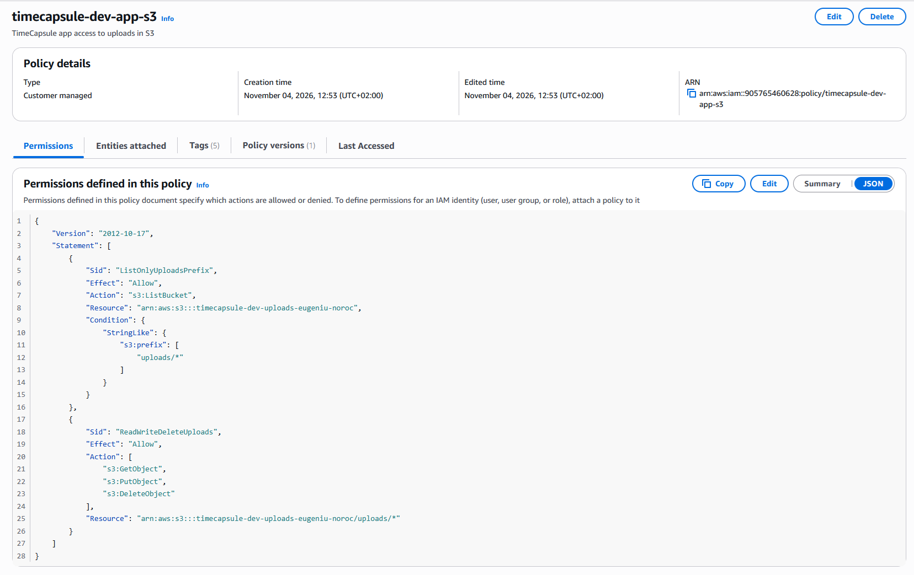  
*Политика `timecapsule-dev-app-s3`.*

```json
{
  "Version": "2012-10-17",
  "Statement": [
    {
      "Sid": "ListOnlyUploadsPrefix",
      "Effect": "Allow",
      "Action": "s3:ListBucket",
      "Resource": "arn:aws:s3:::timecapsule-dev-uploads-eugeniu-noroc",
      "Condition": { "StringLike": { "s3:prefix": ["uploads/*"] } }
    },
    {
      "Sid": "ReadWriteDeleteUploads",
      "Effect": "Allow",
      "Action": ["s3:GetObject", "s3:PutObject", "s3:DeleteObject"],
      "Resource": "arn:aws:s3:::timecapsule-dev-uploads-eugeniu-noroc/uploads/*"
    }
  ]
}
```

**Почему `s3:ListBucket` относится к бакету, а `s3:GetObject` к объекту? Что будет, если перепутать ARN?**
Список объектов — это операция над самим бакетом (запрос «что лежит в бакете»), поэтому её ресурс — ARN бакета без `/`. Чтение, запись и удаление — операции над конкретными объектами, их ресурс — ARN вида `бакет/ключ`. Если перепутать ARN, ни одно правило не совпадёт с запросами: `ListBucket` никогда не применяется к ARN объектов, а `GetObject` — к ARN бакета, и все запросы получат неявный запрет.

### Задание 8. Проверка прав через тестовую роль

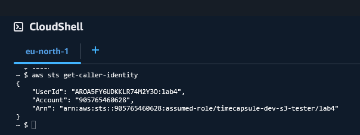  
*CloudShell от имени роли `assumed-role/timecapsule-dev-s3-tester/lab4`.*

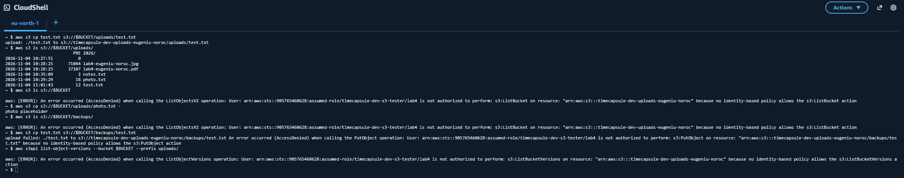  
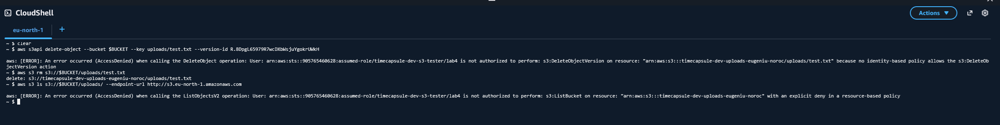  

| № | Команда | Ожидаю | Получил | Какое правило сработало |
|---|---|---|---|---|
| 1 | `aws s3 cp test.txt s3://$BUCKET/uploads/test.txt` | разрешено | разрешено | разрешение в политике приложения (`PutObject` на `uploads/*`) |
| 2 | `aws s3 ls s3://$BUCKET/uploads/` | разрешено | разрешено | разрешение в политике приложения (`ListBucket`, префикс `uploads/`) |
| 3 | `aws s3 ls s3://$BUCKET` | AccessDenied | AccessDenied | неявный запрет (пустой префикс) |
| 4 | `aws s3 cp s3://$BUCKET/uploads/photo.txt -` | разрешено | разрешено | разрешение в политике приложения (`GetObject`) |
| 5 | `aws s3 ls s3://$BUCKET/backups/` | AccessDenied | AccessDenied | неявный запрет (префикс `backups/`) |
| 6 | `aws s3 cp test.txt s3://$BUCKET/backups/test.txt` | AccessDenied | AccessDenied | неявный запрет (`PutObject` только в `uploads/*`) |
| 7 | `aws s3api list-object-versions --bucket $BUCKET --prefix uploads/` | AccessDenied | AccessDenied | неявный запрет (нет `s3:ListBucketVersions`) |
| 8 | `aws s3api delete-object ... --version-id <VersionId>` | AccessDenied | AccessDenied | неявный запрет (нет `s3:DeleteObjectVersion`) |
| 9 | `aws s3 rm s3://$BUCKET/uploads/test.txt` | разрешено | разрешено | разрешение в политике приложения (`DeleteObject`) |
| 10 | `aws s3 ls s3://$BUCKET/uploads/ --endpoint-url http://s3.eu-north-1.amazonaws.com` | AccessDenied | AccessDenied | явный запрет в политике бакета (не HTTPS) |

Все результаты совпали с ожиданиями. Тексты ошибок различаются: при неявном запрете — `because no identity-based policy allows ...`, при явном — `with an explicit deny in a resource-based policy`.

**Чем политика доверия отличается от политики прав? Что произошло с test.txt после команды 9? Сможет ли злоумышленник уничтожить файлы? А если бы было `s3:*`?**
Политика доверия (trust policy) определяет, **кто** может взять роль на себя (здесь — участники моего аккаунта), а политика прав определяет, **что** может делать тот, кто роль взял. После команды 9 `test.txt` не удалён: появился маркер удаления, а версия с содержимым осталась, и файл можно восстановить, удалив маркер. Злоумышленник с учётными данными приложения сможет только скрыть файлы маркерами удаления, но не стереть версии — это восстановимо. С `s3:*` он получил бы `DeleteObjectVersion`, `PutBucketVersioning`, `DeleteBucketPolicy` и т. д. и смог бы безвозвратно уничтожить все данные и настройки бакета.

### Задание 9. Роль сервера

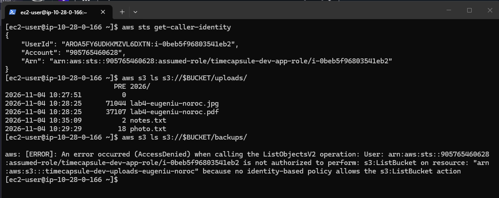  
*На app-server: `assumed-role/timecapsule-dev-app-role/i-0beb5f96803541eb2`, `uploads/` доступен, `backups/` — AccessDenied.*

**Где CLI на сервере взял учётные данные? Чем политика доверия отличается от тестовой? Почему это безопаснее ключа в .env?**
Роль привязана к экземпляру через instance profile. AWS CLI (и SDK) получает временные учётные данные роли из сервиса метаданных экземпляра (IMDSv2, адрес 169.254.169.254), AWS сам их выдаёт и регулярно обновляет. Политика доверия тестовой роли разрешает брать роль участникам моего аккаунта, а роли сервера — только сервису EC2 (`ec2.amazonaws.com`). Такие учётные данные временные (действуют несколько часов и обновляются сами), нигде не хранятся в файлах и не могут попасть в репозиторий; постоянный ключ в `.env` при утечке работал бы бессрочно, пока его не удалят вручную.

### Задание 10. Перенос существующих файлов

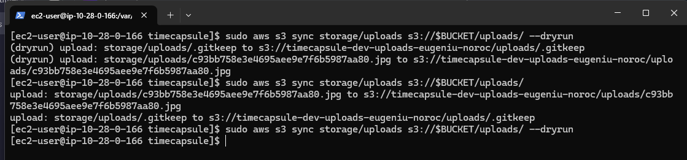  
*`aws s3 sync --dryrun`, настоящая синхронизация и повторный `--dryrun` с пустым выводом.*

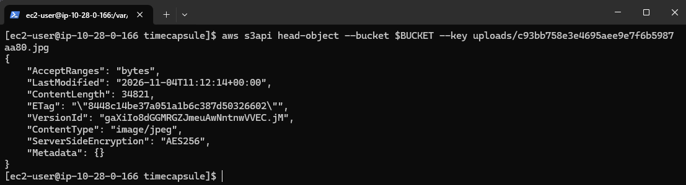  
*Перенесённый файл из ЛР2: `ContentType: image/jpeg`.*

**Хватило ли прав политики приложения? Какие действия использовала команда?**
Да. `aws s3 sync` использовал `s3:ListBucket` (с префиксом `uploads/`), чтобы узнать, какие файлы уже есть в бакете, и `s3:PutObject`, чтобы загрузить недостающие. Команда выполнялась через `sudo`, потому что файлы принадлежат пользователю `apache`; под root CLI получает те же учётные данные роли.

### Задание 11. Модуль хранения на S3

Изменения: <!-- ссылка на коммит "Store attachments in S3 with presigned URLs" -->

- `src/storage.php` — работа с S3 через AWS SDK: `storage_save()` загружает файл (`putObject` с `SourceFile` и `ContentType`), `storage_delete()` удаляет объект (`deleteObject`), `storage_stream()` отвечает редиректом 302 на подписанный URL сроком 5 минут с `ResponseContentType` и `ResponseContentDisposition` (inline/attachment и исходное имя файла);
- `composer.json`, `composer.lock` — добавлена библиотека `aws/aws-sdk-php`;
- `.env.example` — `S3_BUCKET` и `AWS_REGION` вместо `UPLOAD_DIR`, ключей доступа нет;
- `views/layout.php` — в подвале имя бакета вместо `local disk`.

### Задание 12. Деплой и проверка

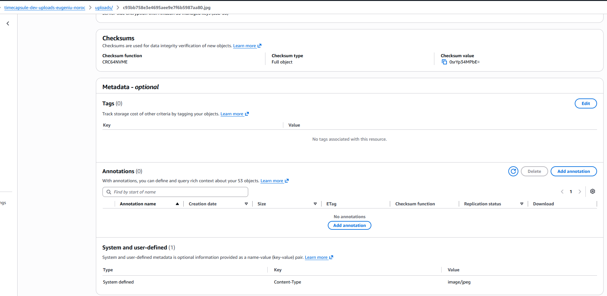  
*Новые объекты в `uploads/` с правильным Content-Type.*

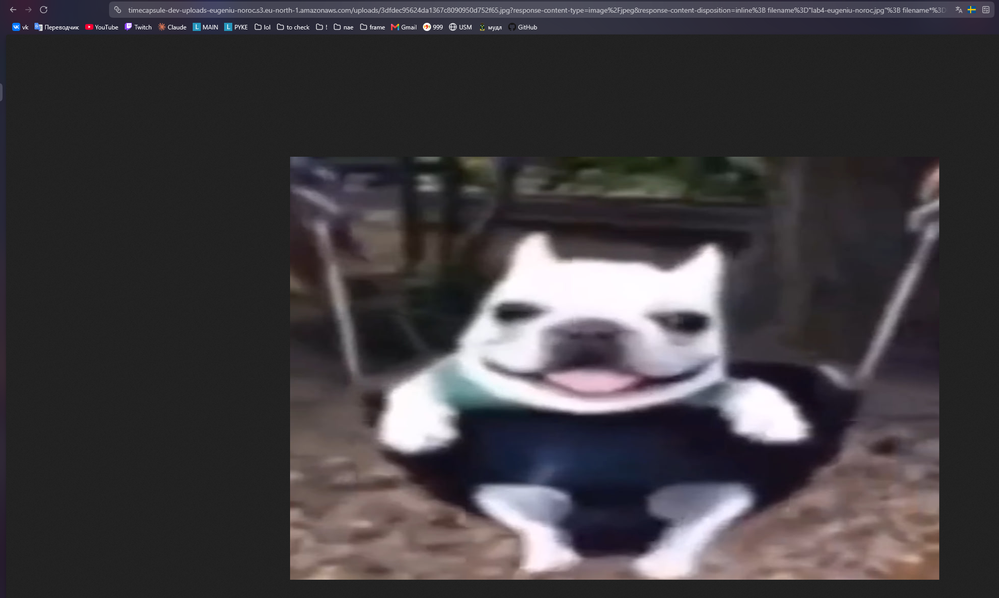  
*Картинка открыта с адреса `...s3.eu-north-1.amazonaws.com/uploads/...` с параметрами `response-content-type`, `response-content-disposition` и `X-Amz-*`.*

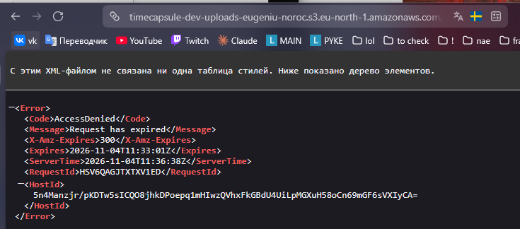  
*Та же ссылка через 5 минут: `Request has expired`.*

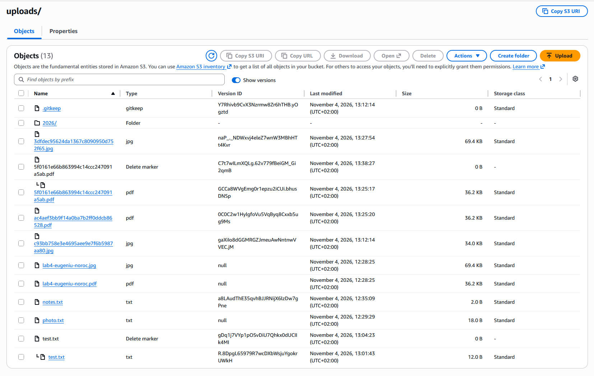  
*После удаления капсулы у её файла появился маркер удаления, версия осталась.*

**Почему пересланную ссылку не нужно отзывать? Что осталось в бакете после удаления капсулы?**
Ссылка действует 5 минут и после этого перестаёт работать сама; кроме того, при каждом открытии вложения приложение заново проверяет права и выдаёт новую ссылку, так что постоянного доступа по старой ссылке не появляется. После удаления капсулы в бакете осталась её версия под маркером удаления. Она стала неактуальной и окончательно исчезнет по правилу жизненного цикла: через 30 дней перейдёт в Standard-IA (если больше 128 КБ), через 90 дней удалится, если у ключа не будет двух более новых неактуальных версий.

### Задание 13. Сервер без состояния

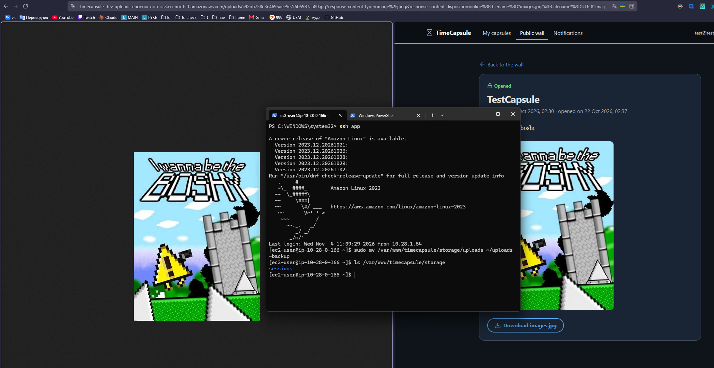  
*В `storage/` осталась только папка `sessions`, вложение капсулы из ЛР2 открывается из S3.*

После проверки политика `timecapsule-dev-app-s3` обновлена (версия v2) без правила `s3:ListBucket`: приложение продолжает работать, а `aws s3 ls s3://$BUCKET/uploads/` на сервере получает `AccessDenied`.

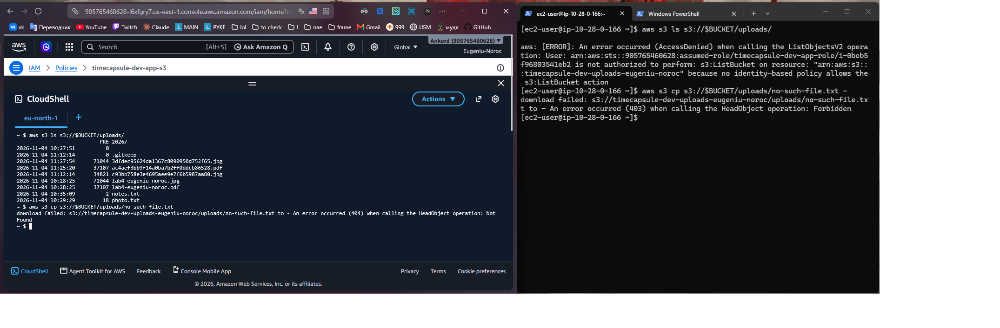  
*Запрос несуществующего объекта: на сервере `403 Forbidden`, в CloudShell `404 Not Found`.*

**Почему S3 ответил по-разному? Зачем? Что нужно сделать, чтобы заменить app-server?**
У роли сервера больше нет `s3:ListBucket`, а без права на список S3 не сообщает, существует ли объект, и на любой отсутствующий ключ отвечает 403. Иначе по разнице 403/404 можно было бы перебором узнавать имена чужих файлов. У моего пользователя право на список есть, поэтому S3 честно отвечает 404. Чтобы заменить app-server, достаточно запустить новый сервер с кодом из репозитория, файлом `.env` и привязанной ролью `timecapsule-dev-app-role`, перенести на него Elastic IP — данные пользователей не переносятся: база на db-server, файлы в S3.

---

## Задание 14. Архитектура и решение

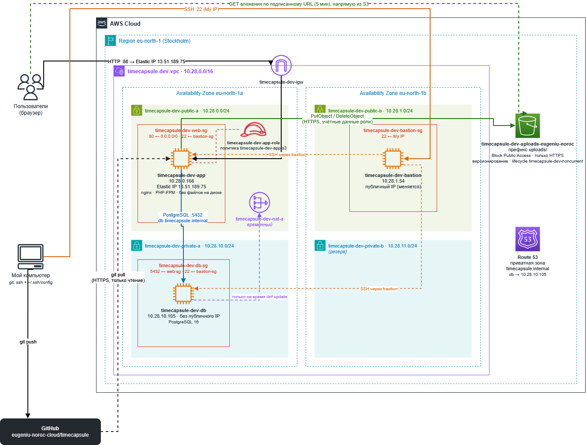  
*Архитектура после ЛР4: бакет S3 в регионе вне VPC, роль сервера, запросы приложения к S3 и скачивание вложений браузером по подписанному URL.*

ADR: [docs/adr/0003-attachment-storage.md](docs/adr/0003-attachment-storage.md)  

---

## Ответы на контрольные вопросы

**1. Как проходит запрос на скачивание вложения? Где проверяются права пользователя, а где права роли?**
Пользователь нажимает на вложение, браузер запрашивает у приложения `/capsules/{id}/file`. Приложение проверяет права пользователя приложения: видна ли ему капсула и открыта ли она. Затем оно подписывает ссылку учётными данными роли сервера и отвечает редиректом 302. Браузер идёт по ссылке прямо в S3; S3 проверяет подпись, срок и права роли, которой подписана ссылка (`s3:GetObject` на `uploads/*`), а также политику бакета (только HTTPS), и отдаёт файл.

**2. Какие настройки бакета и свойства ссылки не дают постороннему открыть вложение по прямому адресу?**
Block Public Access и отключённые ACL не позволяют сделать объекты публичными, поэтому анонимный запрос по прямому адресу получает AccessDenied. Имена файлов случайные. Подписанный URL действует только для одного ключа, только 5 минут и только с неизменёнными параметрами: подмена ключа даёт `SignatureDoesNotMatch`, просрочка — `Request has expired`.

**3. Почему файлы отдаются через подписанный URL, а не через открытый для чтения бакет?**
Открытый бакет отдаёт любой файл любому, кто знает или угадает адрес, без проверки прав пользователя приложения и навсегда. Подписанный URL выдаётся только после проверки прав в приложении и быстро истекает. При этом файл всё равно идёт напрямую из S3, без нагрузки на сервер.

**4. Как изменить схему, чтобы вложения пережили отказ всего региона?**
Включить Cross-Region Replication в бакет в другом регионе (например, eu-central-1) с собственной политикой и версионированием. Для работы в другом регионе нужны и копии остальной инфраструктуры: серверы приложения, база (например, межрегиональная реплика RDS) и переключение DNS (Route 53 failover) на резервный регион.

---

## Использованные источники

- Лекция 6 «Облачные хранилища. Amazon S3»
- [Документация Amazon S3](https://docs.aws.amazon.com/s3/)
- [AWS SDK for PHP: presigned URLs](https://docs.aws.amazon.com/sdk-for-php/v3/developer-guide/s3-presigned-url.html)
