# Лабораторная работа №5. Облачные базы данных. Amazon RDS

| | |
|---|---|
| **Студент** | Noroc Eugeniu |
| **Группа** | IA2404 |
| **Специальность** | Informatică aplicată |
| **Уровень** | Продвинутый |
| **Регион AWS** | eu-north-1 (Stockholm) |
| **Репозиторий** | https://github.com/eugeniu-noroc-cloud/timecapsule |

> Работа выполнялась в регионе **eu-north-1 (Stockholm)** вместо eu-central-1, как и ЛР2–ЛР4; зоны eu-north-1a и eu-north-1b вместо eu-central-1a и eu-central-1b.  
> web-server из Части 1 ЛР3 был удалён, поэтому в Части 1 подключение к базе выполнялось с app-server, которому временно добавлялась Security Group `lab5-web-sg`.  
> Аккаунт AWS на бесплатном плане: срок хранения резервных копий ограничен 1 днём вместо 7.

---

## Часть 1. Базовый уровень

### Задание 1. Размещение и доступ к базе

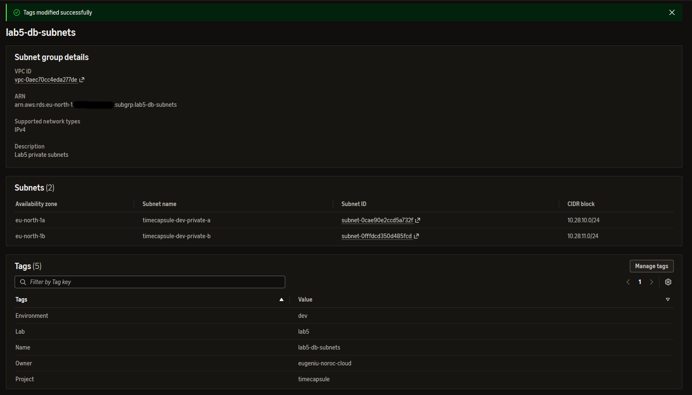  
*Группа подсетей `lab5-db-subnets`: приватные подсети private-a (eu-north-1a) и private-b (eu-north-1b).*

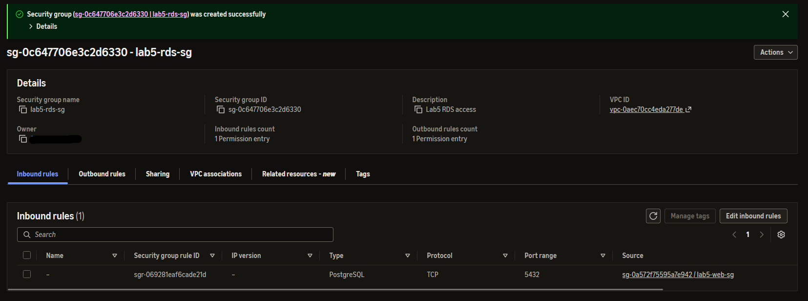  
*`lab5-rds-sg`: порт 5432 открыт только для Security Group `lab5-web-sg`.*

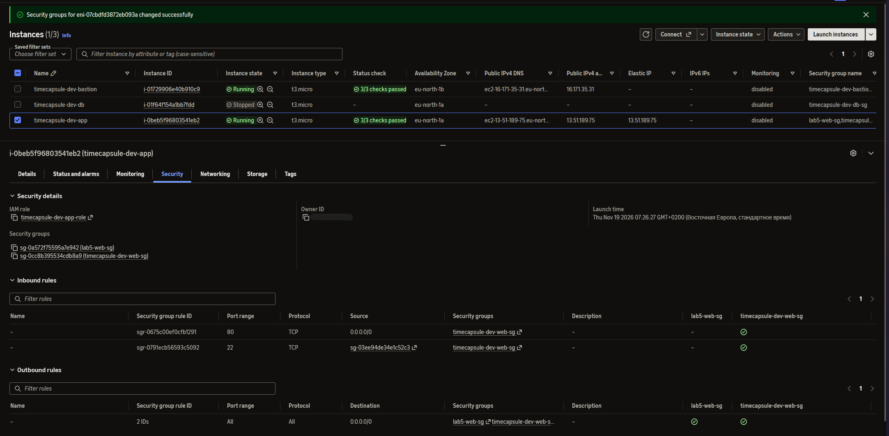  
*app-server с двумя группами: `timecapsule-dev-web-sg` и `lab5-web-sg`.*

**Почему удобнее использовать Security Group источника, а не IP? Зачем две подсети, если база в одной зоне?**  
Правило с группой-источником означает «любой сервер с этой группой», независимо от его адреса: при пересоздании или добавлении серверов правило не нужно менять, а лишние машины в той же подсети доступа не получают. RDS требует, чтобы группа подсетей охватывала минимум две зоны доступности: так база может быть перенесена в другую зону, восстановлена там или получить реплику и резервный экземпляр Multi-AZ без перестройки сети.

### Задание 2. База RDS

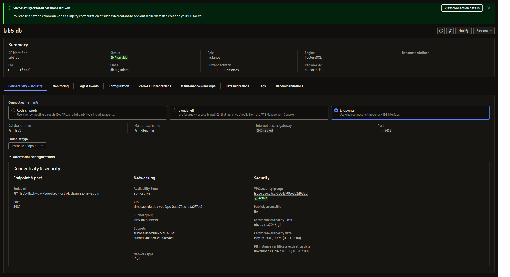  
*`lab5-db`: зона eu-north-1a, группа подсетей `lab5-db-subnets`, группа `lab5-rds-sg`, Publicly accessible: No.*

**Как убедиться, что база принимает подключения только с нужного сервера? Почему eu-north-1a? От чего защищает deletion protection?**  
Публичного доступа у базы нет, её адрес приватный, а единственное входящее правило `lab5-rds-sg` разрешает порт 5432 только от `lab5-web-sg`; проверка ниже показывает, что с app-server порт открыт, а с bastion закрыт. Зона eu-north-1a выбрана, потому что в ней работает app-server: запросы не уходят в другую зону. Deletion protection защищает от случайного удаления экземпляра — пока она включена, базу нельзя удалить; от ошибок внутри базы (`DELETE`, `DROP TABLE`) она не защищает, от них спасают резервные копии.

### Задание 3. Подключение к базе

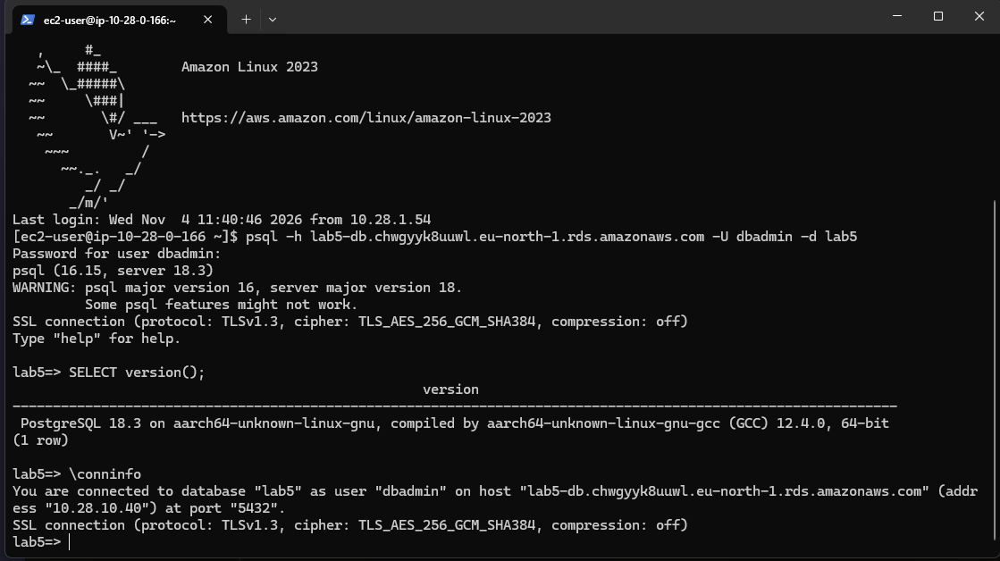  
*`SELECT version()` и `\conninfo`: PostgreSQL 18.3, соединение по TLSv1.3.*

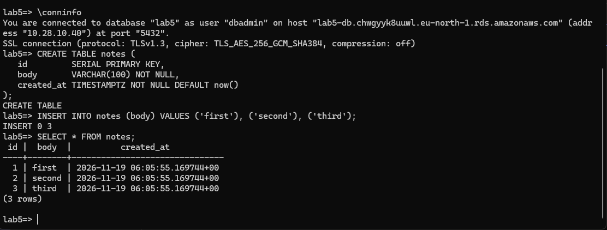  
*Таблица `notes` с тремя строками.*

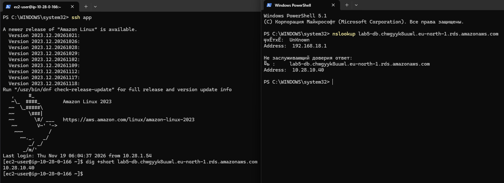  
*Endpoint базы разрешается в приватный адрес `10.28.10.40` и на app-server, и на моём компьютере.*

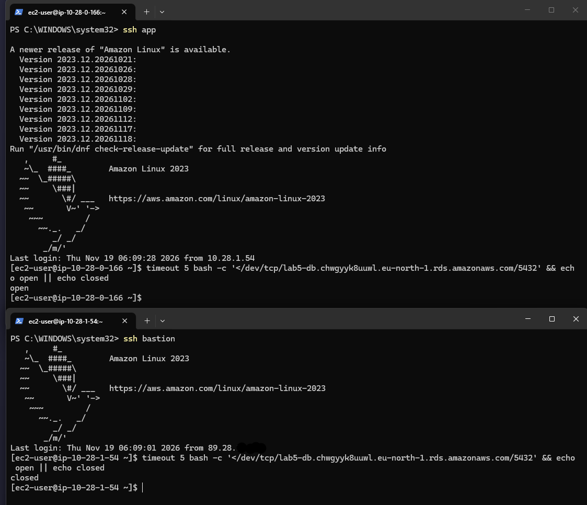  
*Порт 5432 базы: с app-server — open, с bastion — closed.*

### Задание 4. Реплика для чтения

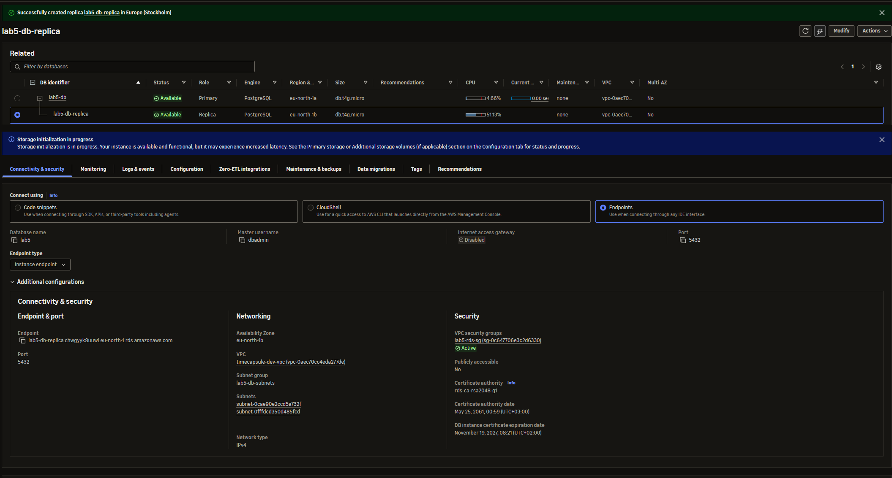  
*`lab5-db` (Primary, eu-north-1a) и `lab5-db-replica` (Replica, eu-north-1b).*

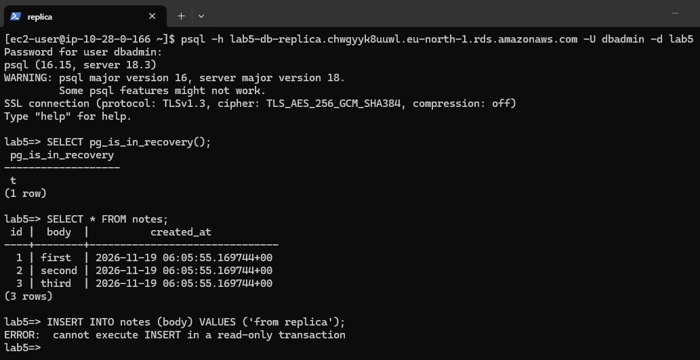  
*На реплике `pg_is_in_recovery() = t`, INSERT завершился ошибкой `cannot execute INSERT in a read-only transaction`.*

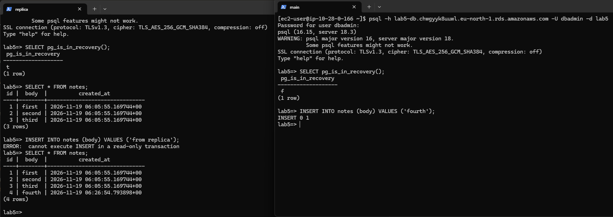  
*На основной базе `pg_is_in_recovery() = f` и добавлена строка `fourth`, на реплике она появилась.*

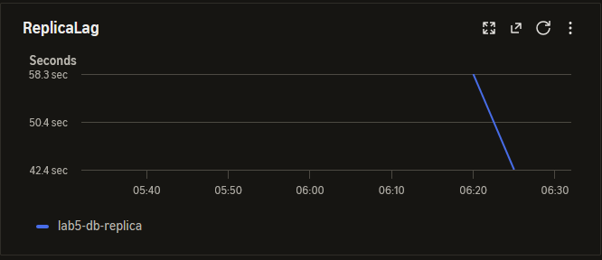  
*Метрика ReplicaLag сразу после создания реплики: отставание уменьшается, пока реплика догоняет основную базу.*

**Почему INSERT на реплике не выполнился? Чем реплика отличается от Multi-AZ?**  
Реплика работает в режиме восстановления (`pg_is_in_recovery() = t`): она только применяет журнал изменений основной базы и принимает запросы на чтение, а любые изменения в ней запрещены. Реплика для чтения — отдельный экземпляр со своим endpoint, данные на неё приходят асинхронно с небольшой задержкой, и она нужна для разгрузки чтения. Резервный экземпляр Multi-AZ получает изменения синхронно, запросов не обслуживает, своего endpoint не имеет и нужен только для автоматического переключения при отказе основной базы.

### Задание 5. Восстановление после ошибки

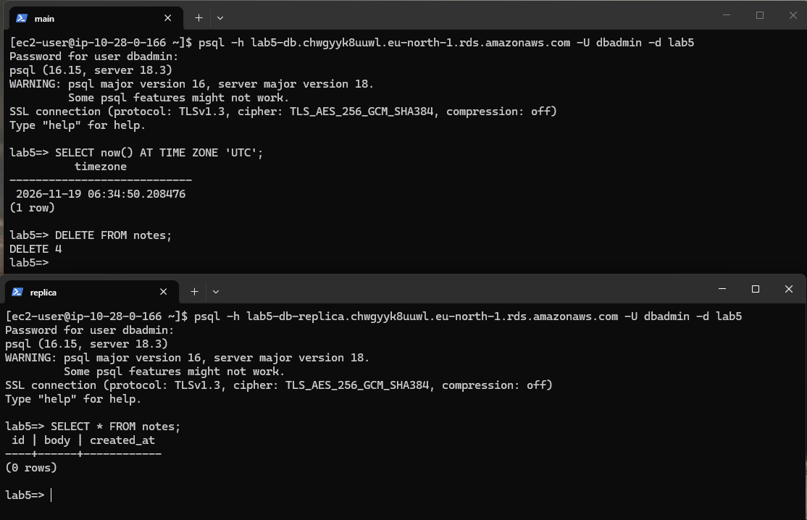  
*Время 06:34:50 UTC, `DELETE FROM notes` на основной базе, на реплике таблица тоже пуста.*

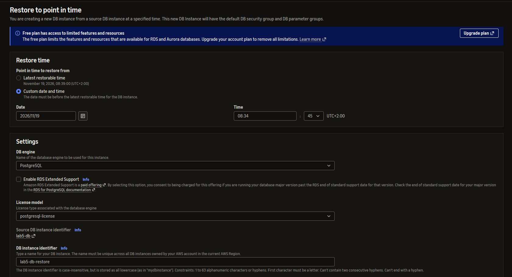  
*Restore to point in time на 08:34:45 (UTC+2), новый экземпляр `lab5-db-restore`.*

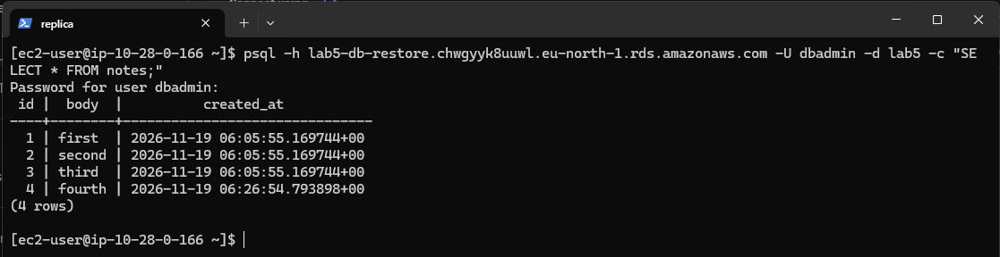  
*В восстановленной копии все 4 строки на месте.*

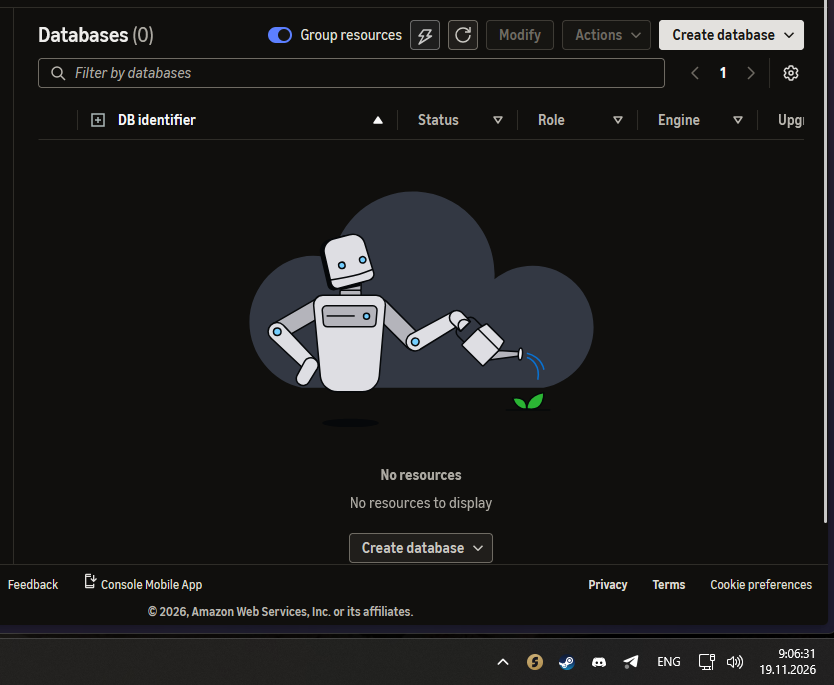  
*После завершения Части 1 учебных баз `lab5-*` не осталось.*

**Почему реплика не спасла данные? Почему восстановление создаёт новую базу?**  
Реплика повторяет все изменения основной базы, в том числе ошибочные: `DELETE` дошёл до неё через доли секунды, и строки пропали и там. Восстановление на момент времени берёт последний снимок и применяет к нему журнал изменений до выбранной секунды; сделать это поверх работающей базы нельзя, поэтому RDS создаёт новый экземпляр. Так исходная база остаётся нетронутой: можно сравнить данные, вернуть только нужные строки или переключить приложение на новую базу.

---

## Часть 2. Продвинутый уровень

### Задание 6. База приложения

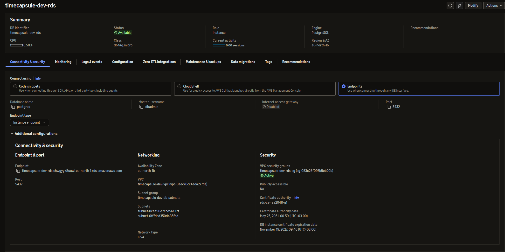  
*`timecapsule-dev-rds`: группа подсетей `timecapsule-dev-db-subnets`, группа `timecapsule-dev-rds-sg` (5432 только от `timecapsule-dev-web-sg`), без публичного доступа.*

База приложения создана с PostgreSQL 18.3 и размещена в зоне eu-north-1b (app-server — в eu-north-1a); соединение между зонами идёт по локальному маршруту VPC.

**Какие параметры вы выбрали бы иначе для рабочей системы?**  
Включил бы Multi-AZ, чтобы база переживала отказ зоны, и увеличил срок хранения резервных копий (14–35 дней), чтобы ошибку можно было исправить даже через несколько дней. Взял бы класс не из линейки burstable, чтобы производительность не зависела от кредитов CPU, включил автоматическое увеличение хранилища, Enhanced Monitoring и экспорт журналов в CloudWatch, а пароль администратора хранил в Secrets Manager. Ночную остановку для рабочей базы не использовал бы.

### Задание 7. Ночная остановка базы

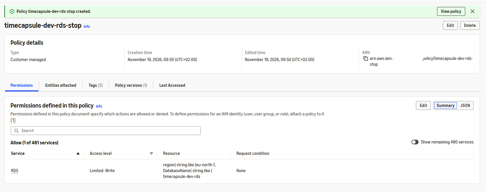  
*Политика `timecapsule-dev-rds-stop`: только `rds:StopDBInstance` для `timecapsule-dev-rds`.*

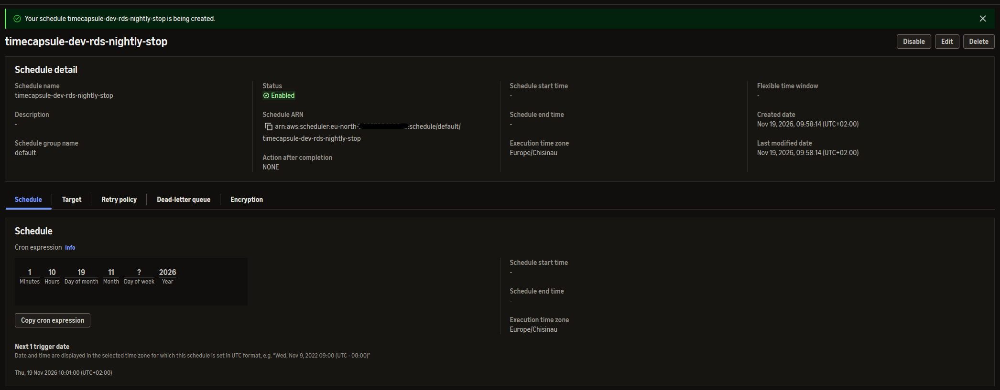  
*Расписание `timecapsule-dev-rds-nightly-stop`, часовой пояс Europe/Chisinau. После проверки выражение заменено на `0 23 * * ? *`.*

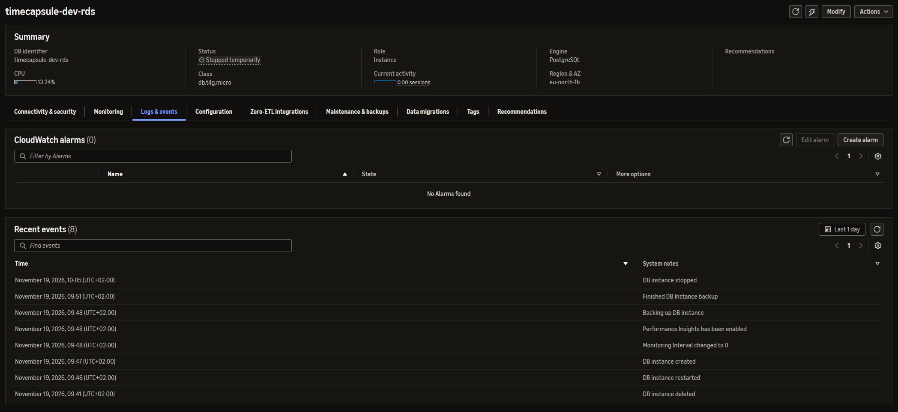  
*Событие `DB instance stopped` после срабатывания расписания.*

**Зачем расписанию своя роль? Почему роль может остановить только одну базу?**  
Scheduler выполняет действие сам, когда меня нет в консоли, поэтому ему нужны собственные учётные данные: он берёт роль, которой доверяет только `scheduler.amazonaws.com`. Принцип минимальных привилегий: роли разрешено единственное действие `rds:StopDBInstance` и только для ARN базы `timecapsule-dev-rds`. Даже при ошибке в расписании или его подмене через эту роль нельзя удалить базу, изменить её или остановить другие базы.

### Задание 8. Пользователь и база данных

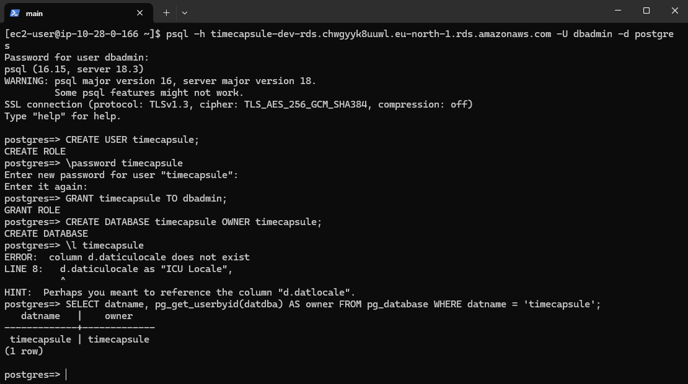  
*Созданы пользователь `timecapsule` и база `timecapsule` с владельцем `timecapsule`.*

**Почему приложению нужен отдельный пользователь, а не dbadmin?**  
`dbadmin` может создавать и удалять базы и пользователей, менять права. Если приложение взломают или в нём будет ошибка, с правами администратора можно уничтожить все базы экземпляра. Пользователь `timecapsule` владеет только своей базой, а пароль администратора не хранится на сервере приложения.

### Задание 9. Перенос данных

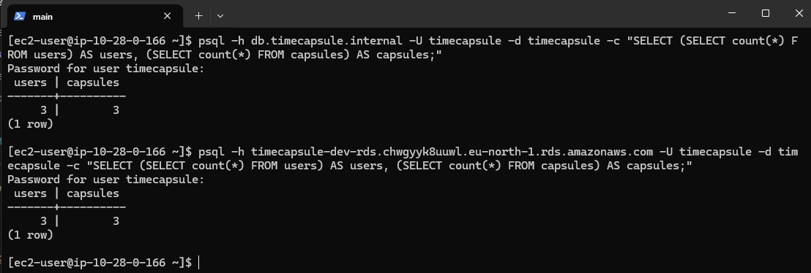  
*В старой базе на db-server и в RDS одинаково: 3 пользователя и 3 капсулы.*

После проверки файл `timecapsule.sql` удалён: в нём хранились хеши паролей пользователей.

### Задание 10. Переключение приложения

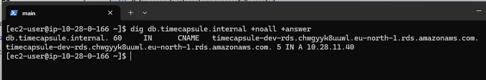  
*`db.timecapsule.internal` — CNAME на endpoint RDS, который указывает на `10.28.11.40`.*

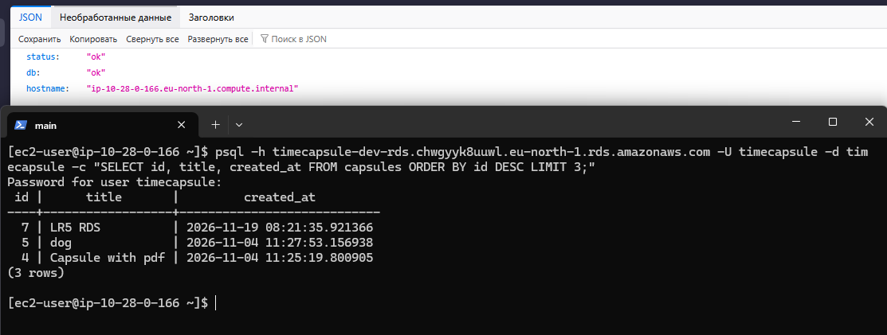  
*`/health` отвечает `db: ok`, новая капсула `LR5 RDS` записана в RDS.*

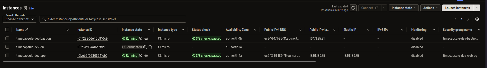  
*db-server `timecapsule-dev-db` завершён, работают только bastion и app-server.*

**Почему не пришлось менять DB_HOST? Какие обязанности перешли к AWS?**  
Приложение обращается к базе по имени `db.timecapsule.internal`, а не по адресу: я заменил только DNS-запись (A на CNAME), и имя стало указывать на RDS. Пароль пользователя `timecapsule` оставлен прежним, поэтому `.env` не менялся. К AWS перешли обновления ОС и СУБД, резервное копирование, восстановление на момент времени, мониторинг и замена вышедшего из строя оборудования. За мной остались схема и данные, пользователи и права в базе, сетевой доступ, выбор параметров и контроль расходов.

### Задание 11. Обслуживание базы

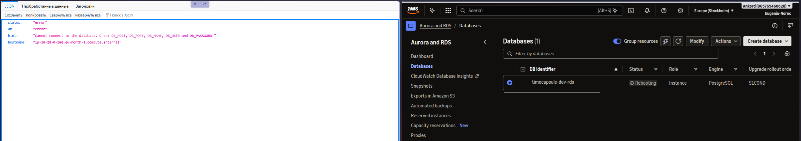  
*`/health` во время перезагрузки базы.*

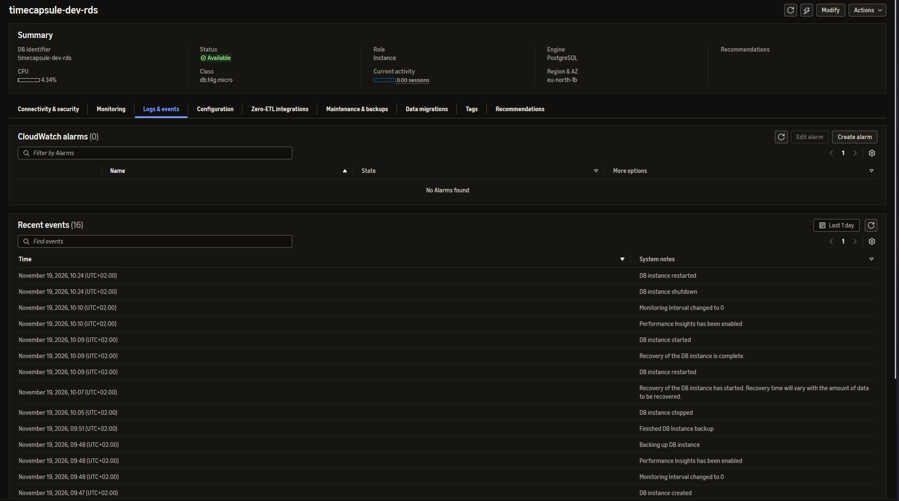  
*Журнал событий базы: остановка, запуск, перезагрузка, резервное копирование.*

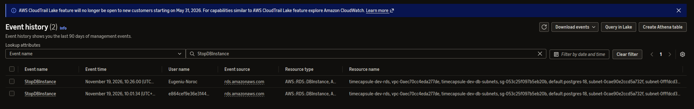  
*`StopDBInstance` в CloudTrail: вызов от роли расписания и ручная остановка.*

**Что показывал /health? Изменился ли endpoint? Какую ошибку получает расписание?**  
Пока база перезагружалась, `/health` отвечал `"db":"error"` (или ждал соединения), а через 1–2 минуты снова `"db":"ok"` — приложение восстановилось само, при следующем запросе открыв новое соединение. Endpoint после остановки и запуска не изменился: он закреплён за экземпляром, меняться может только адрес, на который он указывает. Если база уже остановлена, вызов `StopDBInstance` расписания завершается ошибкой `InvalidDBInstanceState` (экземпляр не в состоянии available).

---

## Задание 12. Архитектура и решение

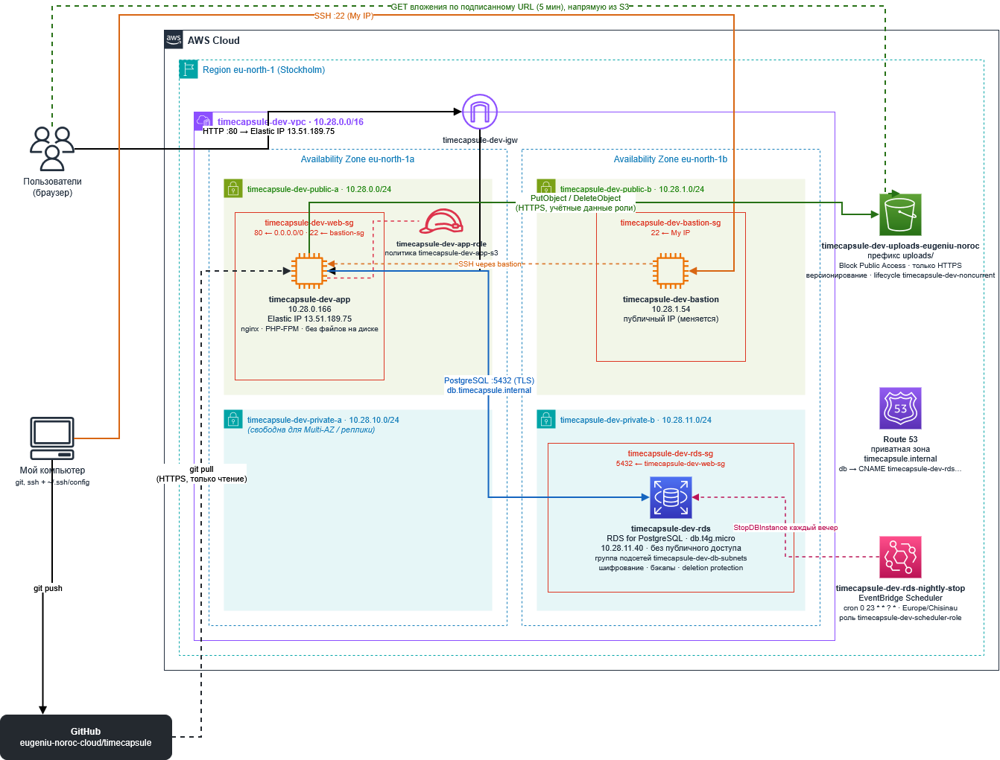  
*Архитектура после ЛР5: база приложения в RDS в приватной подсети, CNAME в Route 53, ночная остановка через EventBridge Scheduler.*

ADR: [docs/adr/0004-database-hosting.md](docs/adr/0004-database-hosting.md)

---

## Ответы на контрольные вопросы

**1. Как проходит запрос от браузера до базы? Какие проверки проходит соединение?**  
Запрос приходит на Elastic IP app-server через Internet Gateway, проходит Network ACL подсети public-a и Security Group `timecapsule-dev-web-sg` (порт 80). Приложение разрешает `db.timecapsule.internal` в приватной зоне Route 53: CNAME на endpoint RDS, затем приватный адрес. Соединение идёт по локальному маршруту VPC в подсеть private-b, проходит её Network ACL и Security Group `timecapsule-dev-rds-sg` (5432 только от `timecapsule-dev-web-sg`), затем RDS требует TLS и проверяет логин и пароль пользователя `timecapsule` и его права на базу.

**2. Чем репликация отличается от резервного копирования?**  
Репликация постоянно поддерживает актуальную копию базы и повторяет на ней все изменения, включая ошибочные, — она защищает от отказа сервера или зоны и разгружает чтение. Резервное копирование сохраняет состояние базы во времени (снимки и журнал изменений) и позволяет вернуться к моменту до ошибки. Поэтому реплика не спасла данные после `DELETE`, а восстановление на момент времени спасло.

**3. Как пережить отказ зоны eu-north-1b и сколько это стоит?**  
Включить Multi-AZ: в другой зоне появится синхронный резервный экземпляр, и при отказе RDS сам переключит endpoint за 1–2 минуты, а CNAME менять не придётся. Это примерно удваивает стоимость базы (два экземпляра и два хранилища, ≈ $28 в месяц при круглосуточной работе вместо ≈ $14) и на бесплатном плане недоступно. Для полной отказоустойчивости нужен ещё второй app-server в другой зоне за балансировщиком нагрузки.

**4. Как вы решили проблему автоматического запуска базы через 7 дней?**  
Расписание EventBridge Scheduler каждый день в 23:00 вызывает `StopDBInstance`. Если AWS запустит базу после 7 дней остановки, в ближайший вечер расписание снова её остановит, поэтому база не может работать круглосуточно больше суток подряд. Если база уже остановлена, вызов просто завершается ошибкой и ничего не меняет.

---

## Использованные источники

- Лекция 7 «Облачные базы данных. Amazon RDS»
- [Документация Amazon RDS for PostgreSQL](https://docs.aws.amazon.com/AmazonRDS/latest/UserGuide/CHAP_PostgreSQL.html)
- [Amazon EventBridge Scheduler](https://docs.aws.amazon.com/scheduler/latest/UserGuide/what-is-scheduler.html)
